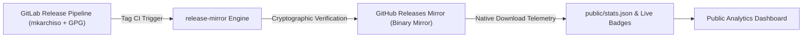

# Snigdha OS Decentralized — Official Binary Mirror & Analytics

[](https://github.com/eshanized/org.snigdhaos.decentralize/releases)
[](https://github.com/eshanized/org.snigdhaos.decentralize/releases)
[](https://github.com/eshanized/org.snigdhaos.decentralize/releases)
[](https://github.com/eshanized/org.snigdhaos.decentralize/releases)
[](LICENSE)

Official public binary distribution mirror, cryptographic release verification engine, and native download telemetry provider for **Snigdha OS Decentralized**.

---

## 1. Project Purpose & Architecture

**Snigdha OS Decentralized** is a privacy-first, amnesic, fail-closed operating system. The canonical source code, build environment, and release packaging pipelines reside on GitLab:

- **Canonical GitLab Source:** [`https://gitlab.com/SnigdhaOS/decentralize/iso`](https://gitlab.com/SnigdhaOS/decentralize/iso)
- **Canonical GitLab Releases:** [`https://gitlab.com/SnigdhaOS/decentralize/iso/-/releases`](https://gitlab.com/SnigdhaOS/decentralize/iso/-/releases)
- **Public GitHub Mirror:** [`https://github.com/eshanized/org.snigdhaos.decentralize`](https://github.com/eshanized/org.snigdhaos.decentralize)

GitLab remains the single source of truth for all builds and signatures. This repository serves as the high-availability binary mirror and leverages GitHub's native release asset `download_count` for transparent, privacy-preserving public download counters.



---

## 2. Public Release Downloads & Mirrors

All release artifacts are cryptographically signed using the official Snigdha OS Release Signing Key:
`2BDB 00AE 6CAB EF0E 4052  0A8F 553F D42B 02A8 211A`.

- **[Browse All Public GitHub Releases](https://github.com/eshanized/org.snigdhaos.decentralize/releases)**
- **[Live Download Analytics Dashboard](https://eshanized.github.io/org.snigdhaos.decentralize/)**
- **[Raw Telemetry Endpoint (`stats.json`)](public/stats.json)**

---

## 3. Cryptographic Verification Quick Start

To verify downloaded releases against the official GPG release signing key:

```bash
# 1. Download verification assets
curl -LO https://github.com/eshanized/org.snigdhaos.decentralize/releases/download/v2026.11.13-rc1/SHA256SUMS
curl -LO https://github.com/eshanized/org.snigdhaos.decentralize/releases/download/v2026.11.13-rc1/SHA256SUMS.sig
curl -LO https://github.com/eshanized/org.snigdhaos.decentralize/releases/download/v2026.11.13-rc1/release-signing-key.asc

# 2. Import and verify trusted signing key
gpg --show-keys release-signing-key.asc
# Expected fingerprint: 2BDB 00AE 6CAB EF0E 4052  0A8F 553F D42B 02A8 211A
gpg --import release-signing-key.asc

# 3. Verify detached signature of the checksum manifest
gpg --verify SHA256SUMS.sig SHA256SUMS

# 4. Verify downloaded ISO integrity
sha256sum -c SHA256SUMS --ignore-missing
```

---

## 4. Operational CLI Tool (`release-mirror`)

The repository includes a production-grade CLI for release operations:

```bash
# Install package locally
pip install -e .

# Inspect status of a release across GitLab and GitHub
release-mirror inspect --tag v2026.11.13-rc1

# Cryptographically verify all release assets
release-mirror verify --tag v2026.11.13-rc1

# Synchronize release from GitLab to GitHub
release-mirror sync --tag v2026.11.13-rc1

# View public download metrics
release-mirror stats

# Regenerate stats.json and public badges
release-mirror stats --output public/stats.json --badges-dir public/badges
```

---

## 5. Documentation Directory

Complete system documentation is maintained under [`docs/`](docs/):

- **[System Architecture](docs/architecture.md)** — Data flow, invariants, and component specifications.
- **[Release Mirroring Workflow](docs/release-mirroring.md)** — Step-by-step synchronization, immutability, and size handling.
- **[GitLab CI/CD Configuration](docs/gitlab-ci-configuration.md)** — `.gitlab-ci.yml` pipeline stage, triggers, and variables.
- **[GitHub Authentication](docs/github-authentication.md)** — PAT token permissions, secret masking, and leak prevention.
- **[Asset & Cryptographic Verification](docs/asset-verification.md)** — Trust hierarchy, detached signatures, and verification protocols.
- **[Download Analytics & Badges](docs/download-statistics.md)** — REST API integration, `stats.json` schema, and badge generation.
- **[Troubleshooting & Diagnostics](docs/troubleshooting.md)** — Resolving rate limits, upload issues, and verification failures.
- **[Operations & Maintenance](docs/operations.md)** — Operator manual commands, health checks, and routine tasks.

---

## 6. License

This project is licensed under the **GNU General Public License v3.0 or later (GPL-3.0-or-later)**. See [LICENSE](LICENSE) for details.
