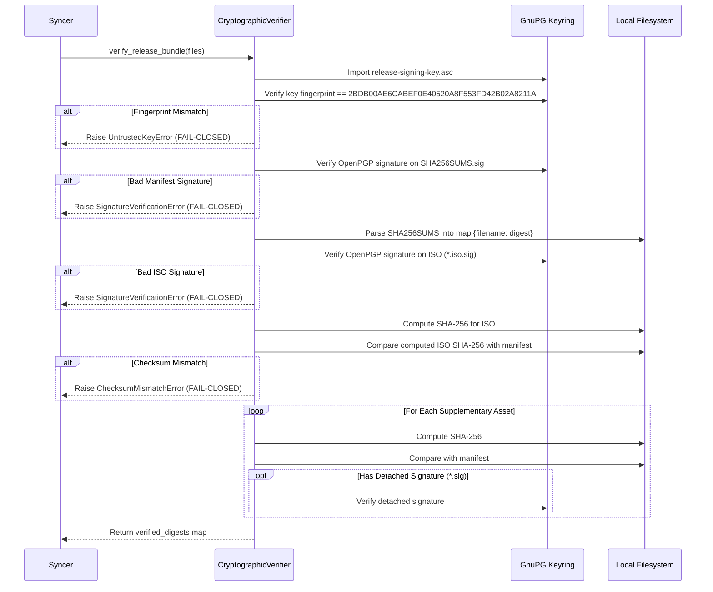

# Release Asset & Cryptographic Verification Specification

**Project:** Snigdha OS Decentralized  
**Canonical Release Key Fingerprint:** `2BDB00AE6CABEF0E40520A8F553FD42B02A8211A`  
**License:** GPL-3.0-or-later  

---

## 1. Security Architecture & Threat Model

Snigdha OS Decentralized operates as a privacy-first, amnesic operating system. A compromised binary mirror represents a critical threat to user security.

Therefore, the mirroring system operates under a **zero-trust boundary** regarding upstream transport:
1. Downloading an asset alongside a manifest does **not** establish its validity.
2. The manifest itself must be cryptographically signed by the official Snigdha OS Release Signing Key.
3. The signing key fingerprint is hard-pinned or configured independently of the release payload.
4. If any single signature, digest, or byte count fails verification, the entire release synchronization is rejected.

---

## 2. Trusted Signing Key Specification

The official Snigdha OS Release Signing Key is specified as follows:

```text
pub   rsa4096 2026-11-11 [SC] [expires: 2028-11-10]
      2BDB 00AE 6CAB EF0E 4052  0A8F 553F D42B 02A8 211A
uid           Snigdha OS Release Signing (dev) <release-dev@snigdhaos.org>
sub   rsa4096 2026-11-11 [S] [expires: 2028-11-10]
      44F1 23CB 101F 8F0F 2E55  5BA4 928E 684F A0D1 0820
```

- **Primary Fingerprint:** `2BDB00AE6CABEF0E40520A8F553FD42B02A8211A`
- **Subkey Fingerprint (Signing):** `44F123CB101F8F0F2E555BA4928E684FA0D10820`

---

## 3. Verification Protocol

The `CryptographicVerifier` module executes the following strict sequence:



---

## 4. Manual Verification by End Users

End users downloading Snigdha OS Decentralized from the GitHub mirror can independently verify artifact authenticity using standard tooling:

### Step 1: Download Release Files
```bash
TAG="v2026.11.13-rc1"
BASE_URL="https://github.com/eshanized/org.snigdhaos.decentralize/releases/download/${TAG}"

curl -LO "${BASE_URL}/snigdhaos-decentralize-2026.11.13-x86_64.iso"
curl -LO "${BASE_URL}/snigdhaos-decentralize-2026.11.13-x86_64.iso.sig"
curl -LO "${BASE_URL}/SHA256SUMS"
curl -LO "${BASE_URL}/SHA256SUMS.sig"
curl -LO "${BASE_URL}/release-signing-key.asc"
```

### Step 2: Verify Checksum Manifest Signature
```bash
gpg --import release-signing-key.asc
gpg --verify SHA256SUMS.sig SHA256SUMS
```
*Expected Output:*
```text
gpg: Good signature from "Snigdha OS Release Signing (dev) <release-dev@snigdhaos.org>"
Primary key fingerprint: 2BDB 00AE 6CAB EF0E 4052  0A8F 553F D42B 02A8 211A
```

### Step 3: Verify ISO Checksum
```bash
sha256sum -c SHA256SUMS --ignore-missing
```
*Expected Output:*
```text
snigdhaos-decentralize-2026.11.13-x86_64.iso: OK
```

### Step 4: Verify ISO Detached Signature
```bash
gpg --verify snigdhaos-decentralize-2026.11.13-x86_64.iso.sig snigdhaos-decentralize-2026.11.13-x86_64.iso
```
*Expected Output:*
```text
gpg: Good signature from "Snigdha OS Release Signing (dev) <release-dev@snigdhaos.org>"
```
