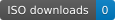

# Public Download Analytics & Badges Specification

**Project:** Snigdha OS Decentralized  
**API Provider:** GitHub REST API v3 / v4  
**Public Endpoint:** `https://raw.githubusercontent.com/eshanized/org.snigdhaos.decentralize/master/public/stats.json`  
**License:** GPL-3.0-or-later  

---

## 1. Overview & Telemetry Philosophy

Snigdha OS Decentralized operates under a strict anti-telemetry invariant:
- The operating system image contains zero telemetry, analytics beacons, or ping-home mechanisms.
- Public download statistics are derived exclusively from GitHub's native release asset `download_count`.
- No separate database, tracking backend, or invasive logging is maintained.

---

## 2. GitHub REST API Ingestion

The analytics engine queries GitHub's official endpoint:

```http
GET https://api.github.com/repos/eshanized/org.snigdhaos.decentralize/releases
```

Every release object contains an `assets` array with native download counts:

```json
{
  "name": "snigdhaos-decentralize-2026.11.13-x86_64.iso",
  "size": 1482342400,
  "download_count": 1420,
  "browser_download_url": "https://github.com/eshanized/org.snigdhaos.decentralize/releases/download/v2026.11.13-rc1/snigdhaos-decentralize-2026.11.13-x86_64.iso"
}
```

The aggregator handles:
1. **RFC 5988 Pagination:** Follows `Link: <url>; rel="next"` to collect all releases.
2. **Draft Filtering:** Excludes unreleased drafts from public statistics.
3. **Asset Categorization:** Separates primary ISO downloads (`.iso`) from auxiliary files (checksums, signatures, SBOMs).
4. **Channel Separation:** Distinguishes stable releases from release candidate prereleases.

---

## 3. Public Data Schema (`stats.json`)

The aggregated data is formatted into a standardized, static JSON payload stored at `public/stats.json`:

```json
{
  "repository": "eshanized/org.snigdhaos.decentralize",
  "generated_at": "2026-11-14T03:04:42Z",
  "totals": {
    "iso_downloads": 1420,
    "asset_downloads": 3280,
    "releases": 1,
    "stable_releases": 0,
    "prereleases": 1,
    "stable_iso_downloads": 0,
    "prerelease_iso_downloads": 1420,
    "stable_asset_downloads": 0,
    "prerelease_asset_downloads": 3280
  },
  "latest": {
    "tag": "v2026.11.13-rc1",
    "version": "2026.11.13-rc1",
    "iso_downloads": 1420
  },
  "releases": [
    {
      "tag": "v2026.11.13-rc1",
      "name": "Snigdha OS Decentralized 2026.11.13-rc1 (Release Candidate 1)",
      "prerelease": true,
      "published_at": "2026-11-13T05:30:12Z",
      "html_url": "https://github.com/eshanized/org.snigdhaos.decentralize/releases/tag/v2026.11.13-rc1",
      "iso_downloads": 1420,
      "asset_downloads": 3280,
      "assets": [
        {
          "name": "snigdhaos-decentralize-2026.11.13-x86_64.iso",
          "size": 1482342400,
          "download_count": 1420,
          "browser_download_url": "https://github.com/...",
          "is_iso": true
        }
      ]
    }
  ],
  "disclaimer": "Metrics represent native GitHub-reported asset download counts via GitHub Releases REST API and do not imply unique visitors or verified successful system installations."
}
```

---

## 4. Official Badges

Badges are available in both **Shields.io Endpoint JSON** (for use with `https://img.shields.io/endpoint?url=...`) and **Standalone Flat SVGs** (independent of external services).

| Badge Purpose | SVG File | Shields JSON Endpoint |
| :--- | :--- | :--- |
| **Total ISO Downloads** | `public/badges/total-iso-downloads.svg` | `public/badges/total-iso-downloads.json` |
| **Latest Release Downloads** | `public/badges/latest-release-downloads.svg` | `public/badges/latest-release-downloads.json` |
| **Total Asset Downloads** | `public/badges/total-downloads.svg` | `public/badges/total-downloads.json` |
| **Latest Version** | `public/badges/latest-version.svg` | `public/badges/latest-version.json` |

### Markdown Embed Examples

```markdown
<!-- Total ISO Downloads Badge -->
[](https://github.com/eshanized/org.snigdhaos.decentralize/releases)

<!-- Latest Version Badge -->
[](https://github.com/eshanized/org.snigdhaos.decentralize/releases)
```

---

## 5. Web Analytics Dashboard

A responsive dark-mode analytics dashboard is provided in `public/index.html`. It automatically reads `stats.json` or falls back to direct client-side GitHub API queries.
